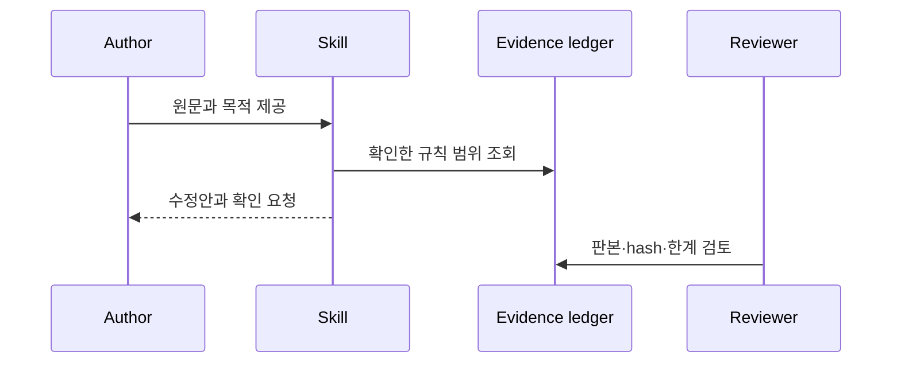

# Product and Technical Gap Baseline

기준 시점: 2026-10-03

관찰 기준(이 문서 변경 직전):
`main@ca94600ed058c0e7448ac69a537b8453241d139b`, Draft PR #5
`f5de04263ea4c3785a8ccbb7bd4ab360e178a986`, Draft PR #6
`2b140986fd4fb4a7715141a249bf12d55e5427be`, Draft PR #4
`6070799af53ed730d90e48b1c1e011eb9ecfdd17`. GitHub branch API는
`main`을 `protected:false`로 보고하며 repository ruleset은 없다.

2026-10-04 재확인: Git 원격·공개 PR 본문에서 PR #4의 descendant
`d7cade69f30ffc580cdb468152ed82dc21c2c4ef`와 PR #5/#6/#4의
94/49/34-file 스택을 확인했다. 위 보호·CI·승인 수치는 과거 관찰이며
이번 `gh` 인증 실패 상태에서 현재 API 값으로 재검증한 것이 아니다.
이번 제한 범위 작업과 수용 기준은 [실사용판 개발 계약](usability-plan.md)에 둔다.
새 Python 패키저가 추가되는 경우 CodeQL 적용 언어를 다시 판단해야 하며,
아래의 과거 skip을 새 head의 성공이나 비적용 판정으로 이어받지 않는다.

상태: Proposed

## Goal과 Loop

**Goal**: 출처 범위를 과장하지 않고 의미를 보존하는 한국어 퇴고와 APA 7
원고 작성 Agent Skill을 독립적으로 설치·검토할 수 있게 한다.

**Loop**: 원문 직접 확인 → source ledger 갱신 → 규칙 최소 수정 → 동결된 합성
사례와 독립 채점 → 공개 hygiene·CI·review → 유효한 default-branch 거버넌스
확인 → ordinary merge → immutable release.

## PRD

| 사용자 | 해야 할 일 | 수용 기준 | 상태 |
| --- | --- | --- | --- |
| 한국어 저자·편집자 | 의미를 보존하며 문장·문단 퇴고 | 수치·불확실성·인용 보존, 과잉 교정 방지 | Proposed |
| 학술 저자 | 확인된 APA 7·JARS 범위로 원고 점검 | 확인 절·쪽과 미확인 범위를 구분 | Proposed |
| 검토자 | 평가 주장의 근거와 한계를 재구성 | 입력·판본·출력·채점·hash·한계 연결 | Partial |
| 실제 사용자·팀 | 실업무에서 설치·호출하고 피드백 제공 | 사용한 스킬 digest·작업 유형·비식별 예문·도움·어색함·의미손실·과잉교정·지연·수정·독립 재검증. 미사용은 미사용으로 기록 | Open — 합성 평가와 별도 |

## TRD

- 배포 단위: `skills/korean-editing/`, `skills/apa7-manuscript-writing/`.
- 근거 정책 경계: 각 skill의 `references/source-ledger.md`. 출처 ID 인용↔장부 정의
  대응은 `tests/source_traceability_test.py`로 검사한다. 규칙 내용의 원문 적합성은
  여전히 사람 검토 대상이다.
- 검증 경계: `evaluations/`, `tests/public_hygiene_test.sh`,
  `tests/skill_structure_test.py`, `tests/source_traceability_test.py`.
- 금지 경계: 사용자 원문·참여자 자료·비밀정보, 검사에 열거한 workstation
  절대경로·ephemeral ID·GitHub/OpenAI/AWS credential·private-key signature.
- 현재 실행 서비스, DB, UI, 인증, container와 network API는 없다.

## UML과 Context Map

Context Map과 구성요소 책임은 `ARCHITECTURE.md`가 소유한다. 처리 순서는
다음과 같다.

## ERD

DB를 소유하지 않으므로 ERD는 적용하지 않는다. 파일 기반 근거를 DB 권위로
가장하지 않는다. 향후 영속 서비스가 생기면 최소 3NF 스키마와 보존·삭제
계약을 별도 ADR에서 정의한다.

## Gap와 Action

| Gap | Evidence | Action | Status |
| --- | --- | --- | --- |
| default branch에 제품 구현과 유효한 보호가 없음 | `main@ca94600e…`에는 `AGENTS.md`와 `README.md`만 있고 branch API는 `protected:false`; repository ruleset 없음 | `.github` canonical owner에서 유효한 조직/default-branch 보호를 입증한 뒤 exact-head 검사·비작성자 review와 ordinary merge | Blocked |
| public hygiene가 중앙 gitleaks skip과 수동 확인에 의존 | PR #4 exact-head Security job과 과거 runtime artifact | RED credential fixture 뒤 `tests/public_hygiene_test.sh`에 GitHub/OpenAI/AWS credential·private-key signature를 fail-closed 통합 | Implemented on PR head |
| Skill 독립 설치 시 repository 외부 문맥에 의존할 수 있음 | `skills/korean-editing/SKILL.md`의 평가 rubric 링크 | package 밖 상대 링크를 fail-closed 검사하고 평가 증거는 실행 의존성에서 분리 | Implemented on PR head |
| 단일 PR이 hosted review 한도를 넘음 | 기존 base-to-head 175 files; CodeRabbit은 100-file 한도로 review를 건너뜀 | PR #5(94 files) → PR #6(49 files) → PR #4(34 files) non-force stack을 유지하고 각 exact head에서 review 수행; 모든 유효 delta는 PR #4 최종 descendant에 보존 | Implemented in PR stack |
| 최신 head의 독립 review 부재 | 2026-10-03 관찰: PR #5/#6/#4 exact head 승인 0건, 각 head의 PR workflow run 0건, CodeRabbit status만 success. 2026-10-06 GraphQL 재조회: PR #5 inline thread 12건과 PR #6 3건이 모두 미해결이며 판정은 `docs/review-followup-20261005.md`에 기록 | 유효한 거버넌스를 만든 뒤 세 current head의 적용 가능한 hosted Checks와 독립 review를 확보 | Blocked |
| **역사 관찰:** 당시 CodeQL 적용 언어 0건 | 당시 head의 CodeQL PR run `36966902575`는 `skipped`; SAST `36966902465`와 Security `36966902494`만 terminal success | 현재 후보에는 Python이 있으므로 canonical CI 담당자가 현재 exact-head 언어 admission·필수 검사 결과를 별도 확인. 과거 skip을 현재 PASS·비적용으로 승계하지 않음 | Historical skip only; current applicability/check unverified |
| outbound LICENSE 미정 | root LICENSE 없음 | 저작권·외부 자료 경계 확인 후 조직 소유자가 결정 | Open |
| APA 원문 확인 범위 불완전 | `TODO.md`, APA source ledger | 필요한 절만 직접 확인하고 미확인은 유지 | In progress |
| 평가의 일반화 근거 부족 | 사례별 1회·자기보고 한계 | 반복·독립 채점 설계를 별도 계획으로 확장 | Open |
| 규칙↔source ID 추적이 수동 | source ledger와 SKILL.md. 2026-10-06 첫 실행에서 정의 없는 `A-STU` 3곳과 APA 요약의 한국어 장부 ID 무표시 인용(U-KHU1–4·G1·G2·J1·J2)을 검출. N-Q3은 검사기가 아니라 DOC-1 요약 동기화로 추가한 항목 | RED/GREEN 대조 시험 뒤 `tests/source_traceability_test.py` 추가. 미정의 `A-STU` 표기 제거, 다른 스킬 장부 ID는 `korean-editing …`로 소유 스킬 명시 | Implemented on PR head — 인식한 ID 형식의 정의 대응만(형식 목록은 `ARCHITECTURE.md`). 규칙 내용의 원문 적합성 자동 판정은 Open |
| immutable 배포 계약 부재 | release/tag 0개 | manifest·version·digest·SBOM·provenance·clean-install conformance·rollback 절차 정의 | Open |
| Issue #2가 폐기된 PR #1을 가리킴 | Issue #2 본문과 successor reconciliation comment | PR #4 successor와 현재 acceptance를 기록 | Implemented on PR head |

## 2026-11-06: Issue #23 범위 갱신

이 절은 아래 과거 release gate나 기존 Gap의 완료 판정을 바꾸지 않는다. 기준은 `main@f0c73fb095b2adf88a3057d529a535caf2126006`과 [Issue #23](https://github.com/ContextualWisdomLab/korean-writing-skills/issues/23)이다.

| Gap | Evidence | Action | Status |
| --- | --- | --- | --- |
| REPORT-23: 리더가 비용 등 증감의 규모를 상세 내역보다 먼저 파악해야 함 | 기존 보고서 지침에는 기존 대비 증감 요약 순서가 없음. Issue #23 사용자 피드백 | `korean-editing`의 보고서 지침·진입점·출처 장부에 상단 요약, 같은 기준의 전후 값·차이·비율, 추정 보존과 계산 예외를 연결. 정적 회귀 계약 및 [합성 7사례 사전 점검·4사례 회귀](../evaluations/runs/report-change-summary-20261106/review.md) | 후보 구현·로컬 검사 완료. 정식 독립 평가·실제 보고서 적용은 미실시. 원격 head·Checks·병합 결과는 해당 PR에서 확인 |

담당 경계는 이 저장소의 `skills/korean-editing/`이며 APA·설치 도구·외부 소비 저장소 변경은 필요하지 않다. 수용 조건은 같은 기준의 기존 대비 방향·대략적 규모를 상단에 먼저 제시하고, 상세 수치·예상·조건을 보존하며 기준값이 없거나 0일 때 비율을 만들지 않는 것이다. Python 3.14와 hosted CI는 로컬 Python 3.12 검사로 완료 처리하지 않는다.

## 2026-11-06: 이력서·보고서·문장 작성 범위 갱신

기준은 `main@f00ab66634d6b0d1496b7ff4d724e0dc0168927b`다. 사용자가 요청한 세 유형의 작성법을 기존 `korean-editing` 안에 보강한다. 새 스킬 패키지·서비스·의존성·개인 설치본은 이 변경 범위에 포함하지 않는다.

| Gap | Evidence | Action | Status |
| --- | --- | --- | --- |
| 이력서의 직무 적합성·개인 기여를 다루는 별도 절차 부족 | 기존 초안·퇴고 지침과 채용 문서 요구 사이의 차이 | `resume-writing.md`와 진입점 추가. 실제 공고·경험·수치·역할을 대조 | 후보 지침 작성, W-CV1–3 근거 확인 |
| 의사결정 보고서의 대안·승인 요청·다음 조치 연결 부족 | 기존 보고서에는 조사·증감 요약 중심의 지침이 있음 | 기존 지침에 독자 결정, 같은 기준의 대안 비교, 관찰·예상·권고 구분 추가 | 후보 지침 작성, W-RPT1–4 근거 확인 |
| 문장의 구체성·호흡을 목적별로 다듬는 경로 부족 | 기존 의미 보존·문장 수리 지침 | `engaging-sentences.md`와 사실에 한정한 합성 예문 추가 | 후보 지침 작성, W-SENT1–3 근거 확인 |
| 기존 함수형 계약 검사 6개가 기본 unittest 명령에서 누락 | 기준판은 113개만 수집. 직접 실행 시 과거 확인 표지 기대값 1건 실패 | 두 모듈에 `load_tests` 연결. 기존 작업 노트 분리 정책에 맞춰 기대값 정정 | 로컬 Python 3.12에서 119개 수집·통과 |

기관 권고 5건과 학술 연구 5건의 직접 열람 범위를 출처 장부에 기록한다. 초록만 확인한 연구를 전문 검토로 표시하거나 외국어권 결과를 한국어 효과로 확대하지 않는다. 구조·출처 연결·공개 파일 검사와 두 preview 패키지의 해시는 로컬에서 확인한다. 원격 Checks·검토·병합은 해당 PR에서 별도로 확인하며, 아래 과거 release gate를 이 변경으로 완료 처리하지 않는다.

[장르별 작성 평가](../evaluations/runs/writing-guides-20261106/review.md)는 기준 동결 후 판본별·사례별 새 실행과 익명 독립 채점으로 진행했다. 기존판 2/3, 보강 v2 3/3이 기준을 충족했다. 보고서 예문을 고친 v3도 동일 기준의 별도 보고서 재실행·독립 채점에서 통과했고 이전 결과를 보존했다. 세 사례의 결과를 일반 성능이나 실제 팀 사용 검증으로 확장하지 않는다. [PR #25](https://github.com/ContextualWisdomLab/korean-writing-skills/pull/25)의 최초 자동 검토 지적은 수정·독립 재검토 후 해결했으며, 이후 CodeRabbit 재검토는 시간당 할당량 제한으로 `neutral` 종료했다. 이를 최신 판본의 자동 검토 통과나 GitHub Actions 검사 통과로 표시하지 않는다.

## 2026-11-06: 능동·피동과 주동·사동의 선택 기준

기준은 `main@0cd3281e075a5644498cf25f85d5563a2ea5ee67`이다. 사용자가 요청한 문법적 지위 확인과 권장·회피 패턴을 기존 `korean-editing` 안에 보강한다. 작성 지침과 근거는 한국어 스킬 담당, 입력·평가 기준은 별도 설계자, 내용 검토와 출력 채점은 작성자와 다른 검토자가 맡는다.

| Gap | Evidence | Action | 완료 기준 |
| --- | --- | --- | --- |
| 일괄 금지 방지는 있으나 능동–피동과 주동–사동의 구분 및 적극적 선택 기준이 흩어져 있음 | 기준판의 퇴고 절차 3과 실전 예문 | 문법 설명·문맥별 권장·수정·유지 조건을 한 참고 문서로 연결 | 공식 자료·학술 근거와 직접 만든 대조 예문, 독립 내용 검토 |
| `-어지다`, `보여지다`, `-시키다`의 표면형만으로 교정할 위험 | 기존 지침은 일부 중첩과 행위자 보존을 다루지만 상태 변화·사동 단계·어휘별 차이를 함께 설명하지 않음 | 실제 의미·참여자·사동 단계를 먼저 확인하고, 중복 교정과 허용 표현을 구분 | 사실을 고정한 두 합성 입력의 기존판·보강판별 새 실행과 독립 채점 |

새 패키지·의존성·서비스·APA 지침 변경은 필요하지 않다. 수용 시에는 출처 연결·구조·공개 파일 검사, 기존 검사 모음과 두 preview 패키지를 확인한다. 이 범위의 문서 보강과 합성 사례 점검은 아래 역사적 release gate나 실제 팀 사용 검증의 완료를 뜻하지 않는다.

[능동·피동·사동 평가 기록](../evaluations/runs/voice-causation-20261106/review.md)은 기존판 2/2, 초기 보강판 1/2, 후속 보강판 2/2의 판정과 인과 강화 실패를 보존한다. 수정 이유와 선택안에도 시간적 선후·인과 구별을 적용하도록 보강하고 별도 내용 검토를 마쳤다. 최초 평가의 허용 범위 밖 메타데이터 노출은 절차상 보류로 기록하고 새 평가자가 재채점했다. 같은 입력의 후속 실행과 채점은 버전별로 구분하며, 평가자가 다른 결과를 일반 개선 효과로 확대하지 않는다.

작업 중 합쳐진 main `6f9fec1`은 통합 커밋 `4439a218`에서 보존했다. 독립 병합 검토 범위에서 누락·지침 충돌을 발견하지 못했고, 통합본의 119개 검사·스킬 구조·출처 연결·preview 파일 21개 대조가 통과했다. 통합본 전체 스킬은 후속 보강 실행 스냅샷과 다르므로 응답 점수를 승계하지 않는다. 정확한 범위는 [통합 기록과 검증](../evaluations/runs/voice-causation-20261106/verification.md)에 있다.

## 2026-11-08: ‘이/가’와 ‘은/는’의 검토 순서

기준은 `main@70b3a9ced7a102c2bda73d0d8ea3b7dd33c152c2`다. 기존판에는 두 조사의 보편적인 우선순위 규정이 없으며, 이번 변경은 선택 근거와 과잉 교정 방지를 명시하는 보강이다.

| Gap | Evidence | Action | 완료 기준 |
| --- | --- | --- | --- |
| 조사 기능을 사용 순위로 확대할 위험과 문맥별 선택 절차 부족 | 기존 문장 수리는 ‘은/는’을 주어 표지로 단정하지 말라고 하지만 두 조사의 선택을 한곳에서 설명하지 않음 | 공식 사전·상담과 담화 연구를 확인하고 문장 관계·질문·구체적 대조·설명을 우선 검토하도록 연결 | 원문과 확인 범위 기록, 독립 내용 검토, 실제 변경·유지 예문의 의미 보존 점검 |
| ‘이/가 우선’, ‘화제·대조이면 은/는’, ‘구정보이면 은/는’의 자동 적용 위험 | 기능 설명만으로 보편적인 선택 순위를 도출할 수 없음 | 행위자 정정·사건 보고·일반적 설명·안긴절·부정 범위의 직접 만든 예문과 채택 조건 추가 | 한 합성 과제의 새 문맥 실행·별도 채점, 구조·출처 연결·공개 자료 검사와 기존 검사 모음 |

스킬 작성·원문 조사·내용 검토·실행·채점의 역할을 구별한다. 한국어 스킬과 대응 문서만 변경하며, APA 스킬·실행 도구·의존성은 이 범위에 포함하지 않는다. 한 합성 과제는 일반 성능이나 수업에서 배운 우선순위의 효과를 검증하지 않는다. [독립 내용 검토와 적용 기록](../evaluations/runs/particle-choice-20261108/review.md)에 동결 입력·기준·스킬 파일 해시·최초 출력·별도 채점을 보존했다. 한 과제는 세 축 모두 3점으로 내부 수용 기준을 충족했고, 기존 자동 검사 152개와 구조·출처 연결·공개 자료 검사를 통과했다. 이 보강으로 아래 역사적 release gate의 완료 상태를 바꾸지 않는다.

## 과거 Release gate

PR #5 → PR #6 → PR #4의 모든 유효 delta가 유효한 default-branch
거버넌스를 거쳐 순서대로 통합되고, 각 exact-head 검사와 독립 review가 끝나며,
release artifact가 생성되기 전에는 GitHub Pages 공개·제품 완료·APA 준수·전체
타당화를 주장하지 않는다.

## 2026-11-08: 스킬 자체 교정

기준 판본은 `main@70b3a9ced7a102c2bda73d0d8ea3b7dd33c152c2`다. 기존 `korean-editing`을 현재 스킬 본문과 안내 문서에 적용했다. 상세 변경, 합성 과제의 적용 판본과 한계는 [자체 교정 기록](../evaluations/runs/self-editing-20261108/review.md)에 있다. 아래 상태는 이번 변경의 로컬 검증 범위이며 과거 출시 조건의 완료 판정을 바꾸지 않는다.

| 부족했던 점 | 확인한 근거 | 조치와 확인 결과 |
| --- | --- | --- |
| 지침 자체를 고칠 때 행동 조건을 대조하는 경로가 분산됨 | 기존 스킬 본문과 별도 검토자의 원문 검토 | 지침·README 경로를 추가하고 의무·권고·허용·금지, 조건·예외·선행 절차를 대조하도록 보완 |
| 짧은 보고, 확인 표식, 학술 시제의 적용 조건이 모호함 | 수정 전 탐색 교정과 원문 검토 | 기준·위치·저자 요청 조건을 명시. 새 합성 과제 네 개의 의미·표현 기준 충족, 후속 변경분 별도 검토 |
| 일반 교정과 학술 점검의 입력 요구가 README에서 섞임 | README와 사용 안내의 입력 설명 대조 | 공통 입력과 학술 원고의 추가 입력을 구별 |
| 전체 검사가 특정 에이전트의 기존 임시 폴더에 의존함 | 업데이트 테스트 9개의 준비 단계 오류 | 표준 임시 폴더를 사용하도록 수정. 관련 9개와 전체 152개 검사 통과 |

원격 브랜치·검사·리뷰·병합 상태는 이 변경을 담은 PR에서 확인한다. 이번 작업은 원격 보호 설정, 출시, 실제 팀 사용 검증을 추가하거나 완료하지 않았다.
